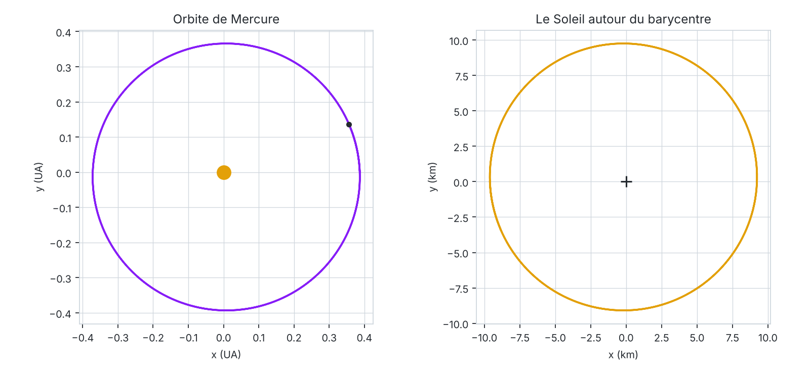

# TIPE · Ce que les orbites révèlent de leur environnement

> 🇫🇷 **Comment les trajectoires orbitales des corps célestes nous apportent-elles des informations sur leurs alentours ?**
>
> 🇬🇧 *How can the analysis of celestial bodies' orbital trajectories yield insights into the characteristics of their surrounding environment?*

<p align="center">
  <picture>
    <source media="(prefers-color-scheme: dark)" srcset="images/orbite-dark.png">
    
  </picture>
  <br>
  <sub>Simulation Soleil–Mercure avec les paramètres de <code>tipe.py</code>. Mercure ne fait pas que tourner autour du Soleil : elle le fait aussi bouger, d'environ 10 km autour du centre de masse. C'est ce type de mouvement que l'astrométrie cherche à mesurer.</sub>
</p>

## Contexte

En prépa MP2I, je dois présenter à l'oral des concours, à l'issue des deux années, un TIPE (Travail d'initiative personnelle encadré) en lien avec le thème de l'année : **Cycles, boucles**.

J'ai toujours été fasciné par le ciel : petit, j'avais un télescope à travers lequel je l'observais. Quand le thème est sorti, l'idée du problème à trois corps m'est tout de suite venue. Après discussion avec mon professeur de physique, j'ai retenu la problématique ci-dessus.

## Démarche

Le projet avance par étapes, selon le temps et la faisabilité de chacune :

1. **Astrométrie.** Montrer que les trajectoires des étoiles, et éventuellement des planètes d'un système, peuvent révéler la présence d'exoplanètes encore non découvertes.
2. **Problème à deux corps.** Modéliser et simuler le mouvement de deux corps en interaction gravitationnelle.
3. **Problème à trois corps.** S'y attaquer si l'avancée du projet le permet.

## Avancement

| Fichier | Contenu | État |
|---|---|---|
| `tipe.py` | Simulation Pygame de corps en interaction gravitationnelle (Soleil et Mercure pour l'instant), intégrée par un schéma d'Euler semi-implicite avec un pas d'un jour | 🚧 En cours |
| `figure_orbite.py` | Génère la figure ci-dessus à partir des mêmes paramètres | ✅ |

## Lancer le projet

```bash
pip install pygame numpy matplotlib
python tipe.py            # simulation (boucle d'affichage en cours d'écriture)
python figure_orbite.py   # régénère les images du README
```

## Sources

*Encore en cours de tri.*

**Méthodes de détection d'exoplanètes**
- [Methods of detecting exoplanets](https://en.wikipedia.org/wiki/Methods_of_detecting_exoplanets) (Wikipédia)
- [Ways to find a planet](https://exoplanets.nasa.gov/alien-worlds/ways-to-find-a-planet/) (NASA)
- [arXiv:1505.06869](https://arxiv.org/abs/1505.06869) : panorama des méthodes de détection, dont l'astrométrie
- [Wobbling stars reveal hidden companions in Gaia data](https://www.esa.int/Science_Exploration/Space_Science/Gaia/Wobbling_stars_reveal_hidden_companions_in_Gaia_data) (ESA)

**Techniques particulières**
- [Thèse HAL tel-01822976](https://theses.hal.science/tel-01822976v1/file/WUNSCHE_2018_diffusion.pdf) : vitesses radiales (pertinence à vérifier)
- [Thèse 2024GRALY032](https://theses.fr/2024GRALY032) : interférométrie
- [arXiv:2301.07018](https://arxiv.org/abs/2301.07018) : imagerie directe

**Autres articles**
- [arXiv:astro-ph/0110635](https://arxiv.org/abs/astro-ph/0110635)
- [arXiv:0705.3072](https://arxiv.org/abs/0705.3072)

**Cours**
- [MIT 12.425 · Extrasolar Planets: Physics and Detection Techniques](https://ocw.mit.edu/courses/12-425-extrasolar-planets-physics-and-detection-techniques-fall-2007/) (MIT OpenCourseWare, 2007)

**Livres**
- A. E. Roy, *Orbital Motion*, Institute of Physics Publishing, 4ᵉ éd., 2005. Ouvrage plus avancé, très cité dans la littérature anglo-saxonne, réputé accessible tout en restant rigoureux.
- R. Bate, D. Mueller et J. White, *Fundamentals of Astrodynamics*, Dover, 1971. Introduction à l'astrodynamique de niveau universitaire.
